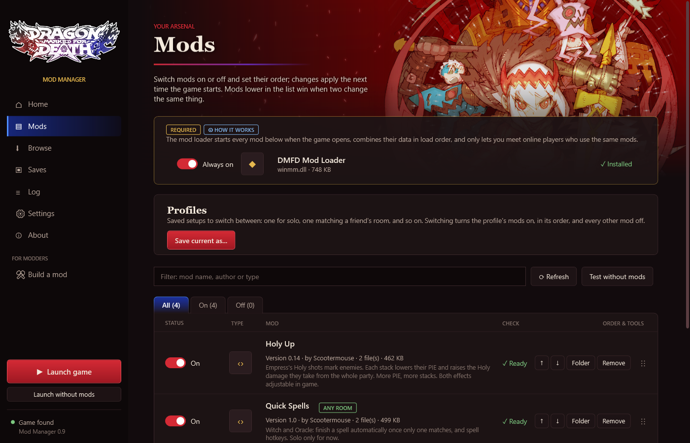
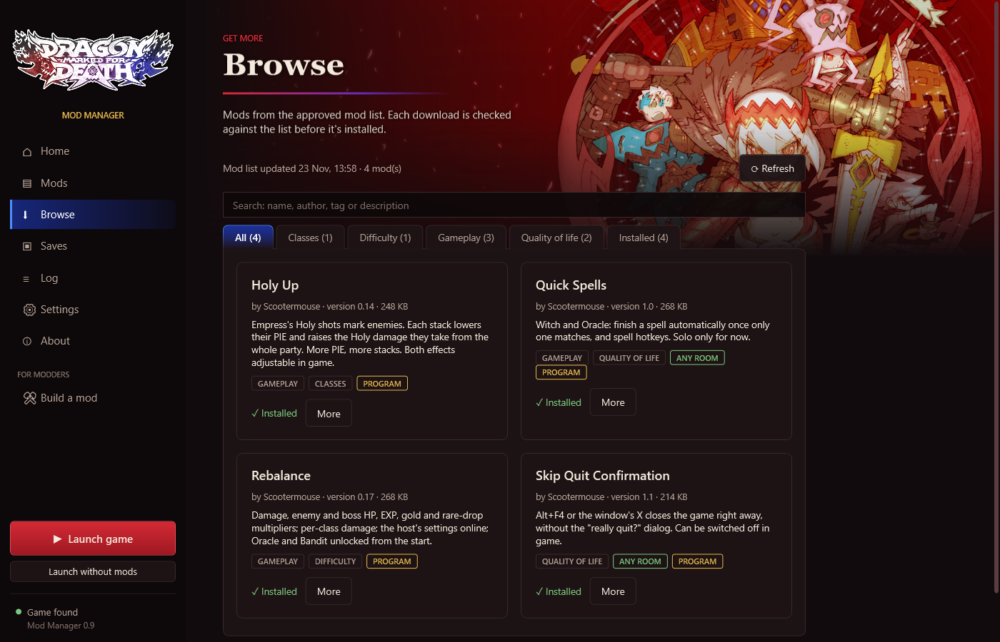
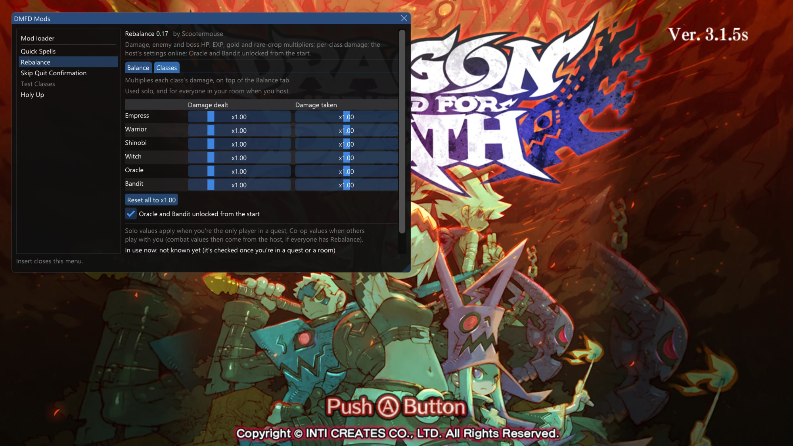

# Dragon Marked for Death Mod Kit

An unofficial, fan-made mod kit for **Dragon Marked for Death** (Steam, Windows). It is a mod
loader, a Mod Manager, a few mods, and the tools to make your own, all without changing any of
the game's own files.

> **Work in progress: version 0.10 is a pre-release.** It's shared early so others can try it,
> check it and build on it, and things will break or change. Back up your saves (the Mod Manager
> does this for you before each launch), and please [report problems](#report-a-problem).

## What's in it

**For players**
- **Mod loader** (`winmm.dll`): starts code mods, serves changed game data, adds extra classes,
  and keeps modded online rooms apart from vanilla ones. In game, **Insert** opens the mod menu.
- **Mod Manager** (`DMFD Mod Manager.exe`): finds the game through Steam, installs mods (drop a
  zip on it), switches them on and off, keeps profiles, backs up saves, combines data mods,
  browses a mod list, and launches the game. Players never need Python.
- **Mods included**
  - **Rebalance**: damage, enemy and boss HP, EXP, gold and rare-drop multipliers, per-class damage.
    Online, the host's settings are used.
  - **Quick Spells**: auto-finish and spell hotkeys for the Witch and the Oracle (solo only).
  - **Skip Quit Confirmation**: quitting from the menu skips the "are you sure?" box.
  - **Holy Up**: an example code mod. The Empress's Holy shots mark enemies; each stack lowers their
    PIE (with the game's own PIE-down badge) and raises the Holy damage they take from the party.

**For modders** (the modding tools: Mod Manager → Build a mod → Get the modding tools; they bring
their own Python)
- Items (change and add), treasure chests, any game text, item icons (redraw and add).
- Every sprite: class bodies, weapons, portraits, menus, the HUD; palettes (colour schemes).
- **Extra classes**: up to 127 in all, on extra pages of character select, each with its own
  name, body, palette, pictures and saved characters, using one of the six classes' moves.
- Body animations: whole new frames, new timing, and new hit boxes per frame.
- Code mods: a small API (`codemods/common`) and a complete example (Holy Up).

Guides: [docs/modding.md](docs/modding.md) (how to make mods), [FORMAT.md](FORMAT.md) (the game's
file formats), [docs/moves.md](docs/moves.md) (how a class's moves work), [docs/holy-up.md](docs/holy-up.md)
(the example code mod), [docs/mod-list.md](docs/mod-list.md) (how the Manager finds mods, now and
later).

## Install

**Download** `DMFD-ModKit-0.10.zip` from the [Releases page](https://github.com/Scootermouse/dmfd-modkit/releases)
(under "Assets"). It's a pre-release: expect rough edges.

1. In Steam, right-click **Dragon Marked For Death** → **Manage** → **Browse local files**. A
   folder opens with `game.exe` in it: that's the game folder.
2. Open the zip and copy **everything** in it into the game folder: `winmm.dll`,
   `DMFD Mod Manager.exe`, `mods.json`, `LICENSE.txt` and the `mods` folder.
3. Double-click **DMFD Mod Manager.exe**. It finds the game and your saves through Steam, backs
   up your save, and prepares the mods (a few seconds).
4. Click **Launch game** (starting the game from Steam also works once the mods are prepared).
5. In the game, press **Insert** for the mod menu: each mod's settings are there.

Windows SmartScreen or an antivirus may warn about the Manager or the DLLs because they aren't
signed. If Windows says "Windows protected your PC", click **More info** → **Run anyway**.

**Switching mods on and off:** the Manager's **Mods** page. Mods that change the game for everyone
in an online room (Rebalance, Holy Up) must match between players; the game tells you what
differs when you try to join a room.

**Updating:** copy a newer kit over the old one (your settings in `mods\<Mod>\` and the
`ModManager` folder are kept).

**Uninstalling:** Mod Manager → **Settings** → **Reset modding**. The loader, the mods and the
prepared data move into the `ModManager` folder (nothing is deleted), so the game runs as it came.
To remove everything, delete `winmm.dll`, `DMFD Mod Manager.exe`, `mods.json` and the `mods`,
`DataMod` and `ModManager` folders.

## Screenshots

The background art is the game's own, read by the Manager from your Steam library.

## Report a problem

1. Close the game, then open **DMFD Mod Manager.exe** → **Log** → **Report a problem**. It makes one
   zip (`ModManager\reports\dmfd_report <date>.zip`) with the game's and the mods' logs and your
   mod list, and opens the folder. The logs are rewritten each time the game starts, so do this
   **before** launching again.
2. Open a new issue on the [Issues page](https://github.com/Scootermouse/dmfd-modkit/issues)
   (a free GitHub account is needed). Say:
   - what you did and what happened (and what you expected);
   - solo or online, and which class;
   - whether it happens again if you repeat it.
3. Drag the report zip into the issue. The logs hold no saves, but they do contain your Windows
   folder paths (which can include your Windows user name); open the zip and look first if that
   matters to you.

A crash right when you close the game with Alt+F4 is normal and shows as a `CRASH` line at the
end of `dmfd_content.log`; you don't need to report that one.

## Known limits

- Steam version on Windows only. The loader checks the game's code at every place it hooks and
  switches a feature off if it doesn't match.
- **Online:** everyone in a room needs the same mods that matter online (the Mod Manager and the
  game tell you what differs). Modded rooms only see modded rooms. Extra classes online have had
  only small tests with two players; Holy Up's stacks online are untested.
- Quick Spells works solo only.
- A character's name once came back blank in an online session. The likely cause (an empty copy
  restored over a class slot) is fixed in 0.9, but it was not reproduced, so report it if you see it.
- Extra classes use one of the six classes' moves. New moves need a code mod; brand-new
  animations can't be added yet (frames, timing and hit boxes can).
- No new stages or quests yet.
- The Mod Manager's icon is a placeholder.

## How it was made

The kit was directed and tested by **Scootermouse**. The code, the reverse engineering of the
game's files and program, and the documentation were written by **Claude** (Anthropic's AI),
working with Scootermouse.

Because a lot of this comes from reading the game's program, the documents say how each finding
was checked: **confirmed in game**, **checked offline** (the tools rebuild the game's own files
byte for byte), or **read from the program only**. Corrections are welcome.

## Building from source

Needs Visual Studio 2019 Build Tools (C++, 32-bit, Windows SDK 10.0.19041.0) and the C# compiler
that comes with them; no downloads.
- `tools\build_dll.bat` builds `build\winmm.dll` (the loader).
- `tools\build_codemods.bat` builds the code mods into `build\mods\`.
- `manager\build.bat` builds `manager\build\DMFD Mod Manager.exe` (.NET Framework 4, which ships with Windows).
- `tools\py.bat tools\make_release.py` makes the player zip; `--tools` makes the modding tools zip
  (unpack python.org's "Windows embeddable package (64-bit)", 3.11, into `tools\python` first).

Each script's `install` option copies the result into the game folder: set `DMFD_GAME` to the
game folder if it isn't Steam's default.

## Licence and credits

- The kit (loader, Mod Manager, tools) is free software under the **GNU GPL, version 3 or later**
  ([LICENSE](LICENSE)).
- The code mod API in `codemods/common` is **MIT** licensed, so mods can use any licence. Each mod
  belongs to its maker (see its `mod.ini`).
- [MinHook](https://github.com/TsudaKageyu/minhook) (BSD 2-clause) and
  [Dear ImGui](https://github.com/ocornut/imgui) 1.91.9 (MIT) are included in `third_party/` with
  their licences.
- The Mod Manager's layout and several features were inspired by UE Mod Manager by KintaroModding.
- Dragon Marked for Death is © Inti Creates. This kit is not made or endorsed by Inti Creates, and
  it contains none of the game's files or art: everything it changes is made on your own machine
  from your own copy of the game.
